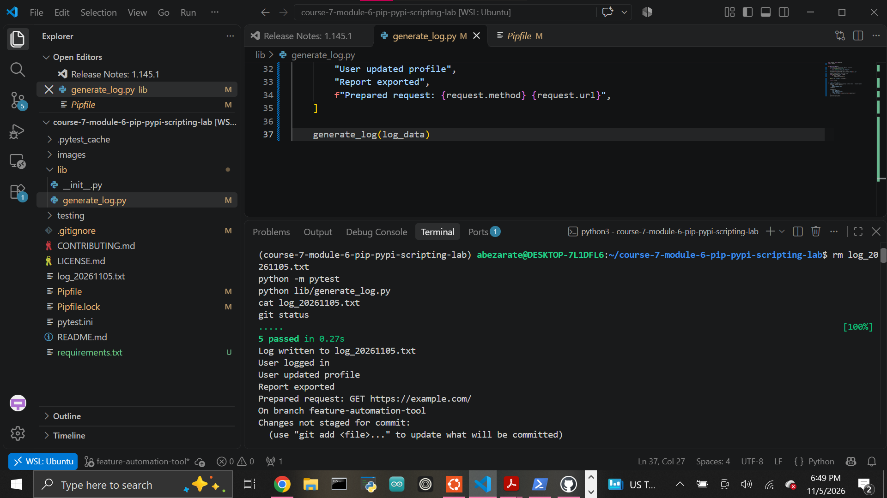

# Python Automation Log Generator

A Python automation project that demonstrates scripting, file I/O, third-party packages, dependency management, and reusable functions.

The project generates dated log files from a list of entries and uses the external `requests` package as part of the script.

## Features

The project can:

- Generate a dated text log file
- Write each supplied log entry on its own line
- Validate input before creating a log
- Handle empty log lists
- Raise a `ValueError` for invalid input
- Print a confirmation message after creating a file
- Return the generated filename
- Use the third-party `requests` package
- Track dependencies with `requirements.txt`
- Ignore generated log files through `.gitignore`

## `generate_log()`

The main function accepts a list of log entries.

```python
generate_log([
    "User logged in",
    "User updated profile",
    "Report exported",
])
```

The function creates a file using the current date:

```text
log_YYYYMMDD.txt
```

For example:

```text
log_20261105.txt
```

Each entry is written to its own line.

## Input Validation

The function requires a list.

Invalid input raises a `ValueError`.

```python
generate_log("This is not a list")
```

An empty list is valid and creates an empty log file.

```python
generate_log([])
```

## External Package

This project uses the `requests` package installed from PyPI.

The script demonstrates use of `requests` by preparing an HTTP request without requiring an active network connection.

```python
request = requests.Request(
    "GET",
    "https://example.com"
).prepare()
```

This keeps the script reproducible while still demonstrating integration with an external package.

## Script Entry Point

The script uses:

```python
if __name__ == "__main__":
```

This allows the `generate_log()` function to be imported by other modules without automatically running the demonstration code.

## Running the Script

Enter the project environment:

```bash
pipenv shell
```

Run the script:

```bash
python lib/generate_log.py
```

Example output:

```text
Log written to log_20261105.txt
```

The generated file contains:

```text
User logged in
User updated profile
Report exported
Prepared request: GET https://example.com/
```

Generated `log_*.txt` files are ignored by Git because they are runtime output.

## Dependencies

Install dependencies using:

```bash
pip install -r requirements.txt
```

The project includes `requests` as an external dependency.

Dependencies are recorded in:

```text
requirements.txt
```

The Pipenv configuration is also stored in:

```text
Pipfile
Pipfile.lock
```

## Testing

Run the automated tests with:

```bash
python -m pytest
```

Current result:

```text
5 passed
```

The tests verify:

- Log file creation
- Correct filename format
- Correct file contents
- Invalid input validation
- Empty-list behavior

## Completed Test Suite



## Project Structure

```text
course-7-module-6-pip-pypi-scripting-lab/
├── images/
│   └── tests-passing.png
├── lib/
│   ├── __init__.py
│   └── generate_log.py
├── testing/
│   ├── __init__.py
│   └── test_generate_log.py
├── .gitignore
├── Pipfile
├── Pipfile.lock
├── pytest.ini
├── requirements.txt
└── README.md
```

## Technologies

- Python
- Pip
- Pipenv
- PyPI
- Requests
- Pytest
- Git
- GitHub

## Author

Abraham Zarate